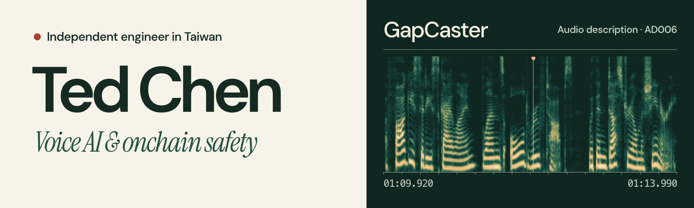

[Try Eleven Seconds](https://tedinroc.github.io/eleven-seconds-arena/) · [Hear GapCaster](https://tedinroc.github.io/gapcaster/#sample) · [2026 results](#user-content-recognition) · [繁體中文](README.zh-TW.md)

I’m Ted, an independent engineer in Taiwan. I build voice tools that run on a laptop and onchain systems that give people time to stop a bad transaction. Here are two you can try.

## Eleven Seconds · Stop a contract upgrade

Propose an upgrade on Monad testnet. Three independently keyed sentinels get 30 blocks to check it. Any one can veto an upgrade that breaks its safety rules. [Try the arena](https://tedinroc.github.io/eleven-seconds-arena/) · [Read the code](https://github.com/tedinroc/eleven-seconds) · [Competition entry](https://mojo.devnads.com/projects/409)

## GapCaster · Hear what happens between lines

Compare the original scene from *Tears of Steel* with a version that adds audio description. GapCaster runs offline and measures each spoken line. In one 2.75-second gap, it sped up a 2.78-second line to play in 2.64 seconds. A reviewer can check each line against its source. [Compare the two cuts](https://tedinroc.github.io/gapcaster/#sample) · [Play the described clip](https://github.com/tedinroc/gapcaster/blob/main/samples/tears-of-steel-0-140/clip_with_ad.mp4) · [Inspect the code and timing data](https://github.com/tedinroc/gapcaster)

## 2026 recognition

| Project | Result and record |
| --- | --- |
| Eleven Seconds | [1st place · Monad Blitz Shanghai V3](https://mojo.devnads.com/events/17?tab=showcase) |
| Upgrade Airlock | [2nd place · ETH Shenzhen 2026](https://github.com/tedinroc/upgrade-airlock#readme) |
| ZeroDrain | [2nd place · Monad Blitz Guangzhou](https://mojo.devnads.com/events/18?tab=showcase) |
| Isotherm | [2nd in MetaMask’s Best Agent Wallet Plugin category · Monad Metropolis](https://x.com/monad/status/2120551113610953111) · [US$750 bounty](https://github.com/tedinroc/isotherm/blob/main/docs/awards/metropolis-metamask-bounty.png) |
| GapCaster | [Finalist, High-Efficiency Development (International Online) · ASUS UGen AI League 2026](https://contest.bhuntr.com/en/39jg9vimiynrhlksze/article/4517/) |
| Hongbao | [Selected for a Wave 2 grant · Mezo Buildathon](https://api.akindo.io/public/wave-hacks/OVOO0gdrVU8379D10/waves/WjDnR6LJaSBkVkQz/submission-summaries?page=1&limit=5&keyword=Hongbao) · [Project entry](https://app.akindo.io/communities/NmgM6k04KCdvpAZ8N/products/Pv1eeQQOVTgXBxv4) |

[View the records in my portfolio](https://tedinroc.github.io/#recognition)

## Recent work

- **ZeroDrain.** Change the withdrawal address and watch the vault refuse it. Once the circuit breaker trips, a previously enrolled passkey can release funds only to a preset recovery address. [Try it on testnet](https://zerodrain-monad.pages.dev/) · [Code](https://github.com/tedinroc/zerodrain-monad)
- **Hongbao.** Friends open a group-chat link to claim equal shares of an MUSD red packet. The two-minute film follows a real transfer in the capped Mezo mainnet beta, including BTC for gas. [Watch the film](https://hongbao.trytry.net/video/) · [Code](https://github.com/tedinroc/hongbao)

## More projects to explore

- **Remote Hands** repairs a Linux test server from console screenshots and keystrokes. A separate probe reboots it and checks SSH access and data integrity. [Replay a repair](https://tedinroc.github.io/remote-hands/) · [Code](https://github.com/tedinroc/remote-hands)
- **Isotherm** settles city-temperature markets against airport weather reports. Its MetaMask Agent Wallet plugin gives agents access to the order book. [Explore a market](https://tedinroc.github.io/isotherm/) · [Code](https://github.com/tedinroc/isotherm)
- **Upgrade Airlock** holds a proxy upgrade until the cooldown expires and onchain clearance is granted. [Watch the demo](https://upgrade-airlock.pages.dev/video/) · [Code](https://github.com/tedinroc/upgrade-airlock)
- **Undo for Bitcoin** lets a phone passkey cancel a pending spend during a public waiting period. [Try the testnet demo](https://undo-btc.pages.dev/) · [Code](https://github.com/tedinroc/undo)
- **KAIKŌ** takes restaurant orders by voice and checks prices before accepting each order. [Watch an order](https://tedinroc.github.io/kaiko/)
- **Voice-agent watch** connects an ESP32-S3 watch to a voice gateway I wrote in Go. [See the prototype](https://tedinroc.github.io/watch/)
- **EARTHRISE** uses real elevation data to render the lunar surface in a browser. [Explore the Moon](https://tedinroc.github.io/earthrise/) · [Tripo showcase](https://developers.tripo3d.com/en/showcase/earthrise)

## How I build

I design the systems, review the code, run the tests and deploy the demos. Claude Code and Codex write most of the implementation. If a demo breaks, an issue in its repository with steps to reproduce it is welcome.

[Portfolio](https://tedinroc.github.io/) · [LinkedIn](https://www.linkedin.com/in/tedinroc) · [X](https://x.com/tedinroc)

[Cover spectrogram from GapCaster’s AD006 narration](https://github.com/tedinroc/gapcaster/blob/main/samples/tears-of-steel-0-140/lines/AD006.wav) · [Portfolio image credits](https://tedinroc.github.io/assets/portfolio/credits.txt)
