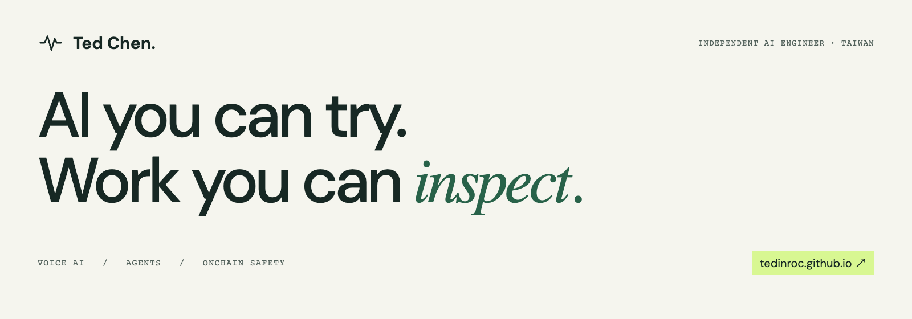
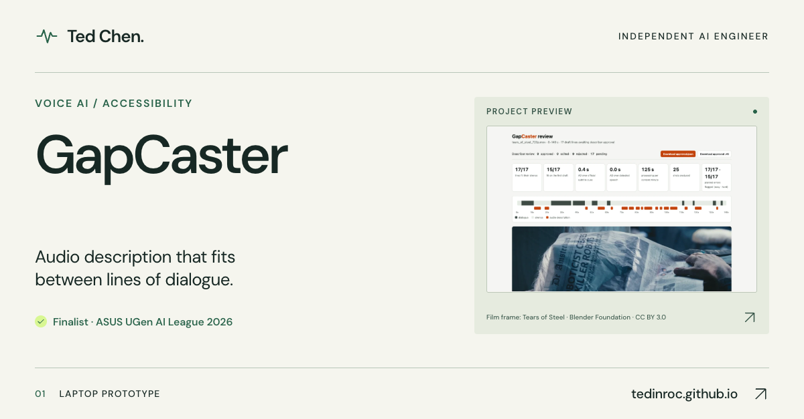
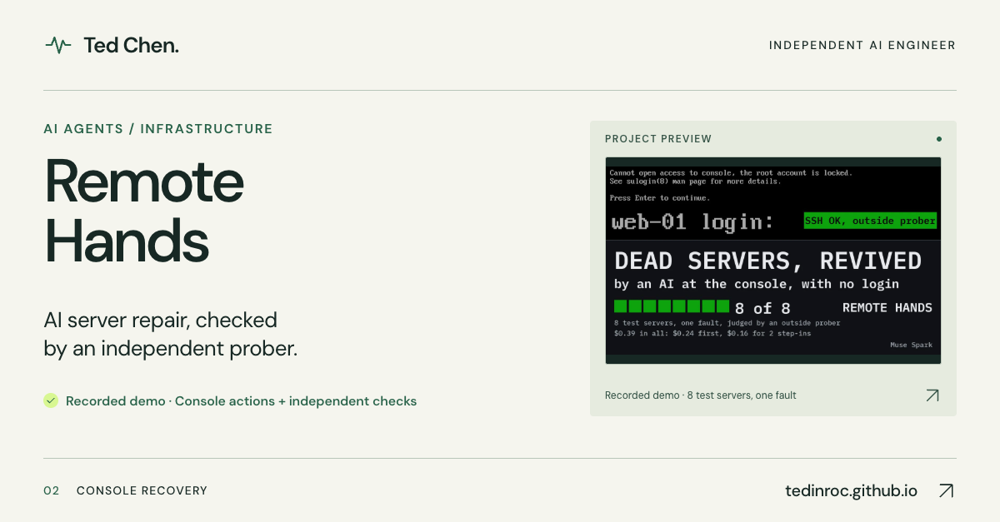
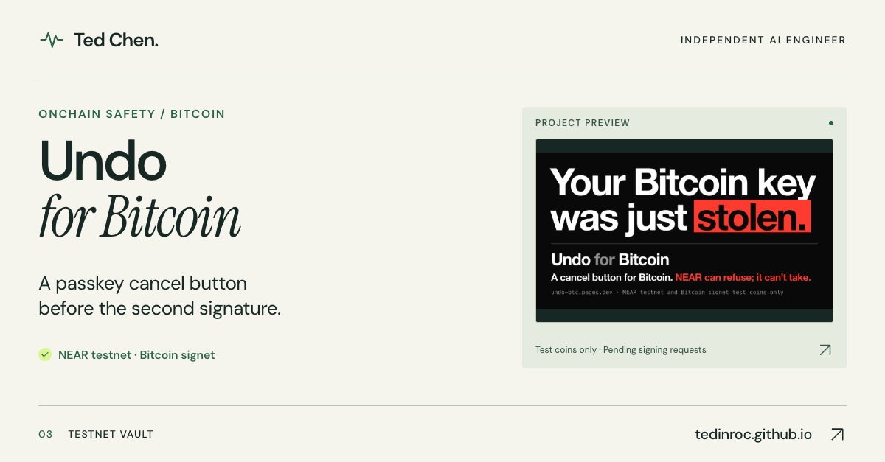

Independent AI engineer in Taiwan. I build **voice AI, agents and onchain safety tools**.

**[Explore the portfolio](https://tedinroc.github.io/)** · [LinkedIn](https://www.linkedin.com/in/tedinroc) · [X](https://x.com/tedinroc) · [繁體中文](README.zh-TW.md)

## Selected work

### GapCaster

Offline audio description that fits between lines of dialogue, with evidence for each line and human review.

Laptop prototype · **ASUS UGen AI League 2026 finalist**

[Watch the sample](https://github.com/tedinroc/gapcaster/blob/main/samples/tears-of-steel-0-140/clip_with_ad.mp4) · [Sample outputs](https://github.com/tedinroc/gapcaster/tree/main/samples/tears-of-steel-0-140) · [Source code](https://github.com/tedinroc/gapcaster)

### Remote Hands

Repairs Linux test servers through the console. An independent probe checks reboot, SSH and data integrity.

Controlled test prototype

[Replay the repair](https://tedinroc.github.io/remote-hands/) · [Film](https://youtu.be/1kL6B0gGCck) · [Source code](https://github.com/tedinroc/remote-hands)

### Undo for Bitcoin

Bitcoin spending with a public waiting period, phone-passkey cancellation of pending signing requests and cold-key recovery, using NEAR Chain Signatures.

NEAR testnet + Mutinynet

[Watch the demo](https://undo-btc.pages.dev/) · [Source code](https://github.com/tedinroc/undo) · [Verification guide](https://github.com/tedinroc/undo#run-it)

### Eleven Seconds

Three sentinels simulate attacks during a 30-block upgrade cooldown and veto rule violations onchain.

Monad testnet · **1st place, Monad Blitz Shanghai V3** · Solo

[Try the attack cards](https://tedinroc.github.io/eleven-seconds-arena/) · [Source code](https://github.com/tedinroc/eleven-seconds) · [Official results](https://mojo.devnads.com/events/17?tab=showcase)

### Upgrade Airlock

Contract upgrades need both a cooldown and clearance after simulation by a Chainlink CRE workflow.

Sepolia testnet · **2nd place, ETH Shenzhen 2026** · Solo

[Watch the demo](https://upgrade-airlock.pages.dev/video/) · [War room](https://upgrade-airlock.pages.dev/) · [Source code](https://github.com/tedinroc/upgrade-airlock)

### Isotherm

City-temperature markets settled from METAR, with Kuru order books and a MetaMask Agent Wallet plugin.

Monad testnet · **MetaMask bounty winner, Monad Metropolis — US$750**

[Explore the project](https://tedinroc.github.io/isotherm/) · [Demo film](https://youtu.be/15AFL_xz_3U) · [Source code](https://github.com/tedinroc/isotherm) · [Award](https://github.com/tedinroc/isotherm/blob/main/docs/awards/metropolis-metamask-bounty.png)

## More experiments

- **[KAIKŌ](https://tedinroc.github.io/kaiko/)** — Voice ordering with server-validated tool calls and prices; a recorded demo-store order.
- **[Voice-agent watch](https://tedinroc.github.io/watch/)** — An ESP32-S3 prototype built on xiaozhi-esp32 and ESP-Claw, with my own Go voice gateway.
- **[EARTHRISE](https://tedinroc.github.io/earthrise/)** — A three.js lunar scene using real elevation data and a Tripo-generated Earth.

## How I work

I design the systems and use Claude Code and Codex to write most of the code. I review, test and ship the results, documenting what was measured and what remains untested.

Tried a project? Bug reports and reproducible test cases are welcome in its repository.

[Image credits](https://tedinroc.github.io/assets/portfolio/credits.txt)
