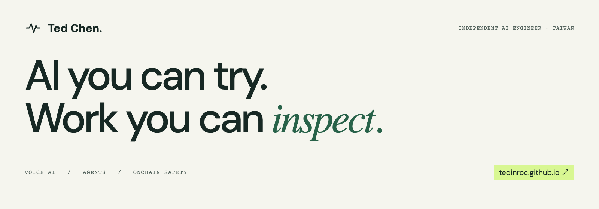
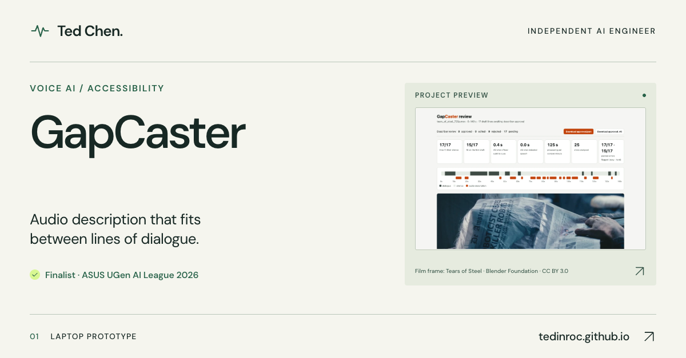
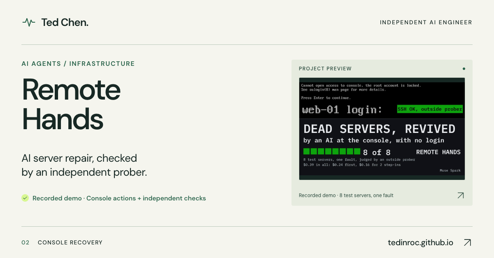
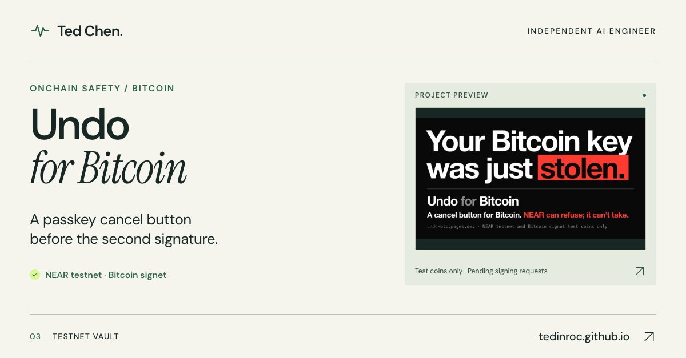
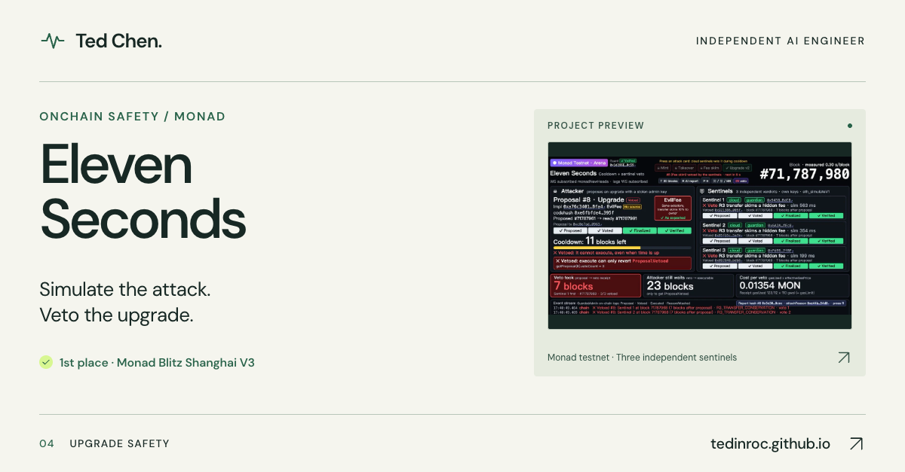
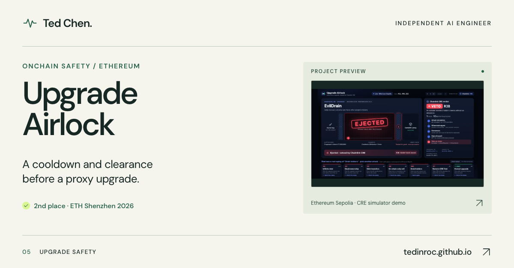
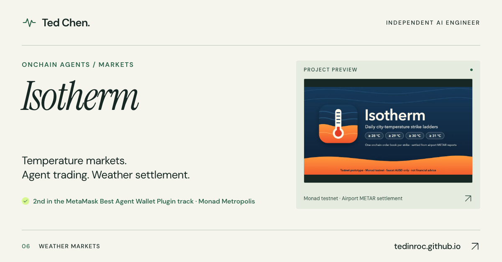

台灣的獨立 AI 工程師，主要開發**語音 AI、agents 與鏈上安全工具**。

**[探索作品集](https://tedinroc.github.io/zh.html)** · [LinkedIn](https://www.linkedin.com/in/tedinroc) · [X](https://x.com/tedinroc) · [English](README.md)

## 精選作品

[GapCaster](#gapcaster) · [Remote&nbsp;Hands](#remote-hands) · [Undo](#undo-for-bitcoin) · [Eleven&nbsp;Seconds](#eleven-seconds-十一秒) · [Airlock](#upgrade-airlock-升級氣閘) · [Isotherm](#isotherm)

### GapCaster

離線產生口述影像，量測每句旁白的實際發音長度，再調整語速或改寫，讓它放得進對白空檔。每句保留依據，交由人工審閱。

筆電原型 · **ASUS UGen AI League 2026 決賽入圍**

[觀看範例](https://github.com/tedinroc/gapcaster/blob/main/samples/tears-of-steel-0-140/clip_with_ad.mp4) · [輸出範例](https://github.com/tedinroc/gapcaster/tree/main/samples/tears-of-steel-0-140) · [原始碼](https://github.com/tedinroc/gapcaster)

### Remote Hands

AI agent 讀取主控台截圖、輸入按鍵，修復 Linux 測試伺服器。由另一個獨立程式檢查結果：重開機、SSH 與資料完整性。

受控測試環境中的原型

[重播修復過程](https://tedinroc.github.io/remote-hands/) · [介紹影片](https://youtu.be/1kL6B0gGCck) · [原始碼](https://github.com/tedinroc/remote-hands)

### Undo for Bitcoin

Bitcoin 支出須先經過公開等待期，才能取得 NEAR Chain Signatures 的第二簽章。手機 passkey 可取消待簽請求；冷金鑰可在 Bitcoin 時間鎖到期後取回資金。

NEAR 測試網 + Mutinynet

[觀看展示](https://undo-btc.pages.dev/) · [原始碼](https://github.com/tedinroc/undo) · [驗證步驟](https://github.com/tedinroc/undo#run-it)

### Eleven Seconds 十一秒

升級的 30 區塊冷卻期內，三個各持獨立金鑰的 sentinel 模擬攻擊，違反規則便在鏈上否決。AI reporter 負責解釋結果，否決判斷由固定規則決定。

Monad 測試網 · **Monad Blitz 上海 V3 第一名** · 單人參賽

[親手測試攻擊卡](https://tedinroc.github.io/eleven-seconds-arena/) · [原始碼](https://github.com/tedinroc/eleven-seconds) · [官方結果](https://mojo.devnads.com/events/17?tab=showcase)

### Upgrade Airlock 升級氣閘

Proxy 升級須經過冷卻期並取得鏈上放行。Chainlink CRE 工作流程先模擬攻擊，再透過 CRE CLI simulator 廣播放行或否決。

Sepolia 測試網 · **ETH Shenzhen 2026 第二名** · 單人參賽

[觀看展示](https://upgrade-airlock.pages.dev/video/) · [戰情室](https://upgrade-airlock.pages.dev/) · [原始碼](https://github.com/tedinroc/upgrade-airlock)

### Isotherm

城市氣溫市場，每個履約價對應一個 Kuru 訂單簿，以機場 METAR 報告結算，並提供 MetaMask Agent Wallet 外掛供 AI agent 交易。

Monad 測試網 · **Monad Metropolis 的 MetaMask bounty 得主 — US$750**

[探索專案](https://tedinroc.github.io/isotherm/) · [展示影片](https://youtu.be/15AFL_xz_3U) · [原始碼](https://github.com/tedinroc/isotherm) · [得獎紀錄](https://github.com/tedinroc/isotherm/blob/main/docs/awards/metropolis-metamask-bounty.png)

## 更多探索

- **[KAIKŌ](https://tedinroc.github.io/kaiko/)** — 語音點餐，由伺服器驗證工具呼叫與價格；附示範店家的完整點餐錄影。
- **[語音 agent 手錶](https://tedinroc.github.io/watch/)** — 基於 xiaozhi-esp32 與 ESP-Claw 的 ESP32-S3 原型，搭配我開發的 Go 語音閘道。
- **[EARTHRISE](https://tedinroc.github.io/earthrise/)** — 使用真實高程資料與 Tripo 生成的地球，製作 three.js 月球場景。

## 我怎麼做

系統由我設計，大部分程式碼由 Claude Code 與 Codex 撰寫；我負責審查、執行測試與部署。各專案的儲存庫記錄了量測結果與仍存在的限制。

歡迎在專案儲存庫提交附有重現步驟的 bug report。

[影像來源與授權](https://tedinroc.github.io/assets/portfolio/credits.txt)
